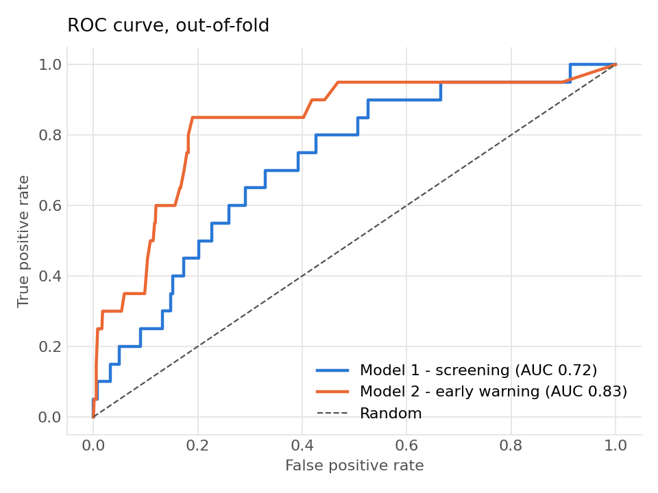
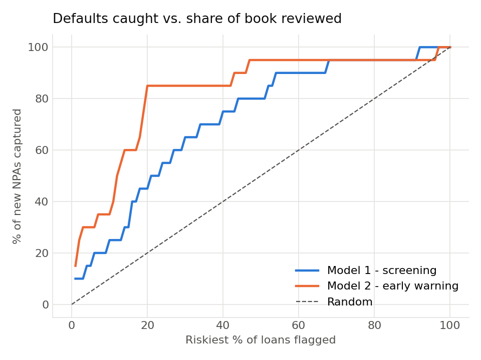
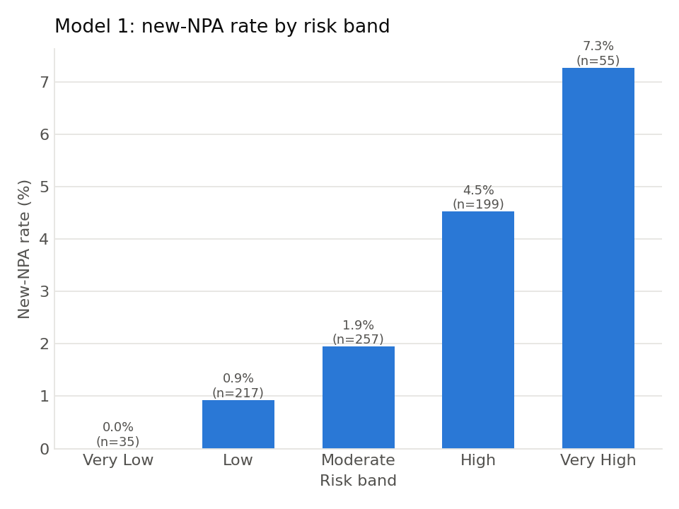
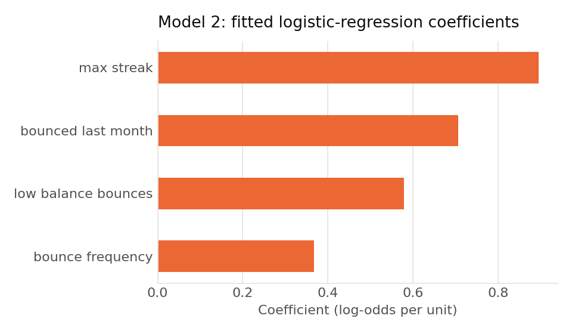

# Credit Risk Early-Warning System

A two-stage credit risk framework for a small-ticket MSME / retail lender. It screens loan applicants at origination, then monitors repayment behaviour and flags performing loans that are likely to become NPAs, so collections teams can step in early.

I originally built it at a technology-enabled lender in India on a book of about 800 loans. **This repository runs on synthetic data** with the same structure, because the original portfolio data is confidential. The method is the same, but the numbers below are from the synthetic data, not from the original portfolio.

## The problem

A small lender has two decisions to make, and they need different information:

| Decision | When | Information available | Model |
|---|---|---|---|
| Should we approve this loan? | Application | Bureau score, LTV, FOIR, income, product, profession, region | **Model 1: Screening** |
| Which performing loans should collections call this month? | Every month | Repayment behaviour (EMI bounces and why they happened) | **Model 2: Early warning** |

## Approach

**Data cleaning.** Bank and NACH files report the same failed EMI in many spellings ("Insufficient Balance", "4-Balance Insufficient", "fund insuffieient"). The pipeline maps them to five categories: low balance, not presented, account issue, mandate issue, and technical.

**Behavioural features** (April–June observation window):
- `bounce_frequency`: the number of months with a failed EMI.
- `max_streak`: the longest run of consecutive bounce months.
- `low_balance_bounces`: the number of bounces caused by insufficient funds.
- `bounced_last_month`: whether the loan bounced in the latest month of the window.

**Target.** An **NPA** is a loan 90 or more days past due (the RBI definition). Loans already NPA in April are excluded. The model predicts *new* NPAs by August.

**Model 1, screening.** An ordinal logistic regression (`statsmodels` `OrderedModel`) on origination features. It predicts a 0–4 risk tier (Healthy, Low, Moderate, High, Severe), and the result is rescaled to a 0–100 score with five bands.

**Model 2, early warning.** A logistic regression (`scikit-learn`) on the behavioural features. It outputs the probability that a loan becomes an NPA, and uses class weighting because defaults are rare (about 3% of loans).

**Validation.** 5-fold stratified cross-validation, so every loan is scored by a model that never saw it in training. The metrics are AUC, KS (the standard scorecard separation metric), and the **capture rate**: the share of future NPAs found in the riskiest X% of the book.

## Results (synthetic data, out-of-fold)

| Metric | Model 1: Screening | Model 2: Early warning |
|---|---|---|
| AUC | 0.72 | 0.83 |
| KS | 0.37 | 0.66 |
| New NPAs captured when reviewing the riskiest 20% of loans | 45% | 85% |
| New NPAs captured when reviewing the riskiest 30% of loans | 65% | 85% |

763 performing loans, 20 new NPAs. Default rates rise steadily across Model 1's bands (0% → 0.9% → 1.9% → 4.5% → 7.3%).

| | |
|---|---|
|  |  |
|  |  |

**What this means for the business:** behaviour beats application data. A collections team that calls only the riskiest fifth of the book, ranked by Model 2, reaches most loans before they turn into NPAs. Model 1 is weaker on its own, but it is the only signal available at origination. It is best used to route borderline applications to manual review, not to auto-reject them.

## Design decisions and what I'd fix next

- **Avoiding target leakage.** Model 2 sees bounces only up to June and predicts the August outcome. My first version used bounces from the same months as the outcome, which inflates accuracy because the model watches the default happen instead of predicting it.
- **Out-of-sample metrics.** The first version reported metrics on the training data. They are now cross-validated.
- **Stable estimation.** Dropping one reference level per categorical variable fixed a singular-Hessian error in the ordinal model.
- **Consistent scoring.** New borrowers are encoded and scaled with the training columns, scaler and score range, so a single applicant gets the same score they would get inside the training batch.
- **Next steps.**
  - A time-based backtest across several cohorts.
  - Confidence intervals: with about 20 to 30 defaults, AUC is uncertain by roughly ±0.05.
  - Calibration of predicted probabilities.
  - A fairness review of `state` and `profession` as predictors.
  - Trying gradient boosting against the logistic baseline.

## Run it

```bash
pip install -r requirements.txt
python run_pipeline.py                  # generates synthetic data, trains, validates, writes reports/
pytest -q                               # unit tests for the feature logic
jupyter notebook notebooks/walkthrough.ipynb
```

To run on your own data, provide two CSVs with the schema in `src/credit_risk/synthetic.py`:

```bash
python run_pipeline.py --loans loans.csv --bounces bounces.csv
```

## Repository layout

```
src/credit_risk/
  synthetic.py     # synthetic loan book + bounce history generator
  features.py      # bounce-reason cleaning, behavioural features, NPA labels
  models.py        # ScreeningModel (ordinal logit), MonitoringModel (logistic), scoring
  evaluation.py    # AUC, KS, capture rate, default rate by band
run_pipeline.py    # end-to-end run -> reports/metrics.json + figures
notebooks/walkthrough.ipynb
tests/
```

**Stack:** Python · pandas · NumPy · statsmodels · scikit-learn · SciPy · matplotlib · pytest
